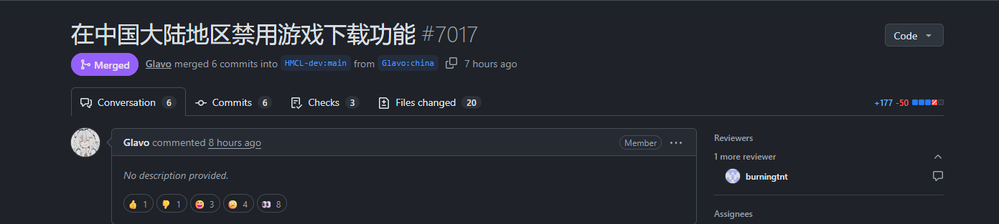

# HMCL RegionPatch
## R.I.P.
HMCL 于2026.10.21日正式合并相关功能到主线，该项目用于绕过某些地区的下载限制。


- 不修改 HMCL 源码，不修改 HMCL 的 JAR，不替换文件。
- 通过 `-javaagent:` 在 HMCL 自己的 JVM 启动时注入，并修改相应逻辑。
- 仅供学习参考，请于24h内删除，本项目于HMCL没有任何附属关系。

> 适用版本：**HMCL 3.17+（nightly / main）**

---

## 1. 目录结构

```
.
├── build.gradle.kts                  # Kotlin DSL 构建脚本（Shadow 打包、smokeTest）
├── settings.gradle.kts               # 仓库与插件版本
├── gradle.properties                 # Kotlin / Byte Buddy / Shadow 版本
├── gradlew, gradlew.bat, gradle/     # Gradle Wrapper 8.10
├── src/main/kotlin/org/jackhuang/hmcl/patch/RegionPatchAgent.kt
│                                     # Agent 主体（premain + Byte Buddy）
├── src/fixture/java/...              # 与 HMCL 同 FQN 的测试桩
├── src/harness/java/...              # 独立 JVM 行为断言
├── src/preload/java/...              # 仅测试用：先加载目标类，覆盖 retransform 路径
├── start-hmcl-with-patch.bat         # 一键启动脚本（临时设置 HMCL_JAVA_OPTS）
└── tools/RegionProbe.java            # 可选：对真实 HMCL JAR 做反射探针
```

构建产物：

```
build/libs/RegionPatch.jar            # 最终 Agent（含 Byte Buddy，可直接使用）
build/libs/RegionPatch-1.0.0-thin.jar # 瘦 JAR，仅调试用，不要拿去 -javaagent
```

---

## 2. 如何使用

### 2.1 启动项
用 JAR 直接启动：

```powershell
java -Xmx2G -javaagent:".\RegionPatch.jar" -jar HMCL.jar
```


### 2.2 一键启动脚本

仓库根目录以及Release为Winodws用户提供了 `start-hmcl-with-patch.bat`脚本，双击即可，不需要改任何系统设置：

用法：

1. 把 `start-hmcl-with-patch.bat`、`RegionPatch.jar` 与 `HMCL.exe` 放到同一目录；
2. 双击 `start-hmcl-with-patch.bat`；

### 2.3 永久设置（可选）

图形界面：`Win + R` → `sysdm.cpl` → 高级 → 环境变量 → 新建用户变量。

PowerShell（当前用户，永久）：

```powershell
setx HMCL_JAVA_OPTS '-Xmx2G -javaagent:"C:\Tools\RegionPatch\RegionPatch.jar"'
```

`setx` 之后需要重新登录（或重启资源管理器），双击启动的 EXE 才会读到新值。

### 2.4 对于Linux用户
You Know How To Do.

---

## 3. 构建

要求：

- **JDK 17 或 21**


```powershell
# 任选一个 17/21 的 JDK
$env:JAVA_HOME = "C:\Users\<you>\.jdks\ms-17.0.16"

.\gradlew.bat build
```

只打包：

```powershell
.\gradlew.bat shadowJar
```
---
## 4. 免责声明

本项目仅用于个人学习与本地环境适配。修改 HMCL 的区域判断可能影响其下载源选择等行为，
请自行评估风险；HMCL 官方不对使用本补丁产生的任何问题负责。

---
## License
该程序在 GPLv3 开源协议下发布
